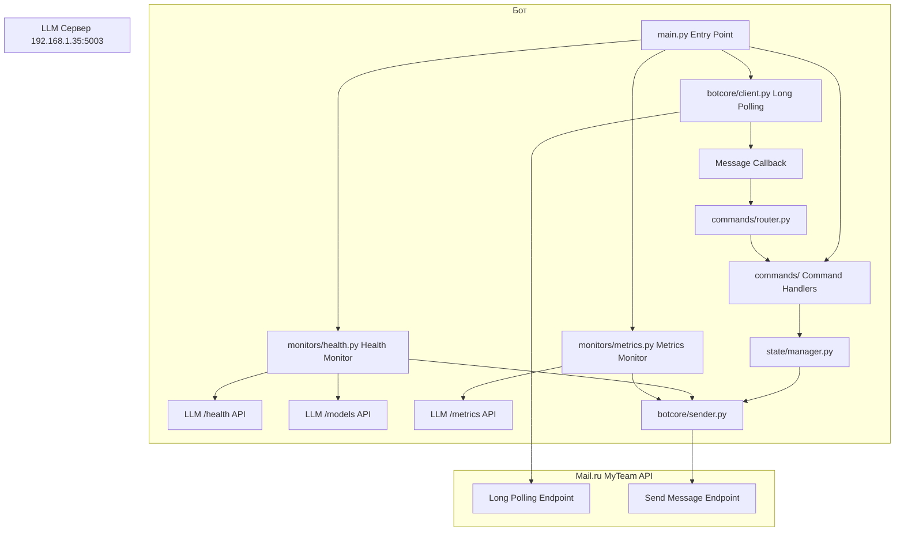
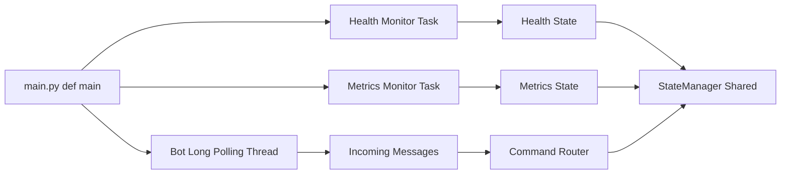
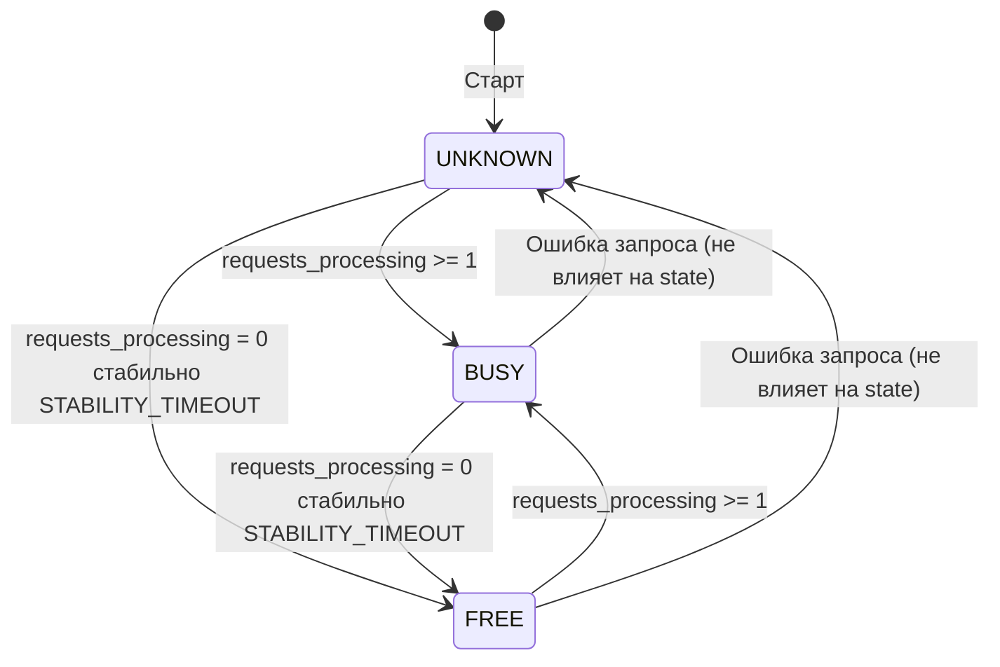

# Архитектура бота мониторинга LLM для Mail.ru MyTeam

## 1. Обзор системы

Бот работает в канале Mail.ru MyTeam (VK Workspace) и выполняет две основные функции:
- **Фоновый мониторинг**: периодический опрос LLM сервера (health + metrics)
- **Интерактивные команды**: ответ на запросы пользователей в канале



## 2. Структура проекта

```
llm-bot/
├── .env                    # Переменные окружения (в gitignore)
├── .env.example            # Шаблон переменных
├── .gitignore
├── main.py                 # Точка входа, инициализация бота
├── README.md               # Документация
├── requirements.txt        # Зависимости проекта
│
├── config/
│   ├── __init__.py
│   └── settings.py         # Pydantic Settings для .env, валидация типов
│
├── botcore/
│   ├── __init__.py
│   ├── client.py           # Обёртка над mailru-im-bot SDK (long polling, JSON patch)
│   └── sender.py           # Отправка сообщений в канал с дедупликацией
│
├── monitors/
│   ├── __init__.py
│   ├── base.py             # Базовый ABC монитора (tick + run цикл)
│   ├── health.py           # Монитор здоровья LLM (/health + /models)
│   └── metrics.py          # Монитор метрик LLM (/metrics)
│
├── commands/
│   ├── __init__.py
│   ├── router.py           # Роутер команд (register + handle)
│   ├── status.py           # /status — статус занятости
│   ├── tokens.py           # /tokens — токены в секунду
│   ├── model.py            # /model — информация о модели
│   ├── context.py          # /context — размер контекстного окна
│   ├── health.py           # /health — статус здоровья
│   └── info.py             # /info — сводка: токены + модель + контекст
│
├── state/
│   ├── __init__.py
│   └── manager.py          # Менеджер состояний (async state machine)
│
├── utils/
│   ├── __init__.py
│   ├── cgi_compat.py       # Полифил cgi для Python 3.13+ (PEP 594)
│   └── http_client.py      # httpx.AsyncClient с retry/backoff для LLM API
│
└── tests/
    ├── __init__.py
    ├── conftest.py         # Фикстуры pytest (state_manager, http_client_mock, sender_mock)
    ├── test_state_manager.py  # 17 тестов: state machine, метрики, модель
    ├── test_router.py          # 11 тестов: регистрация, парсинг, ошибки
    └── test_health_monitor.py  # 8 тестов: health check, cooldown, /models
```

### Файлы и их ответственность

| Файл | Описание |
|------|----------|
| [`main.py`](main.py) | Инициализация asyncio event loop, graceful shutdown (SIGINT/SIGTERM), запуск мониторов и бота |
| [`config/settings.py`](config/settings.py) | Pydantic BaseSettings для .env, валидация BOT_TOKEN и CHANNEL_ID |
| [`botcore/client.py`](botcore/client.py) | Обёртка над mailru-im-bot SDK, патч `requests.Response.json()` для защиты от JSONDecodeError |
| [`botcore/sender.py`](botcore/sender.py) | Отправка сообщений в канал с дедупликацией и dry-run режимом |
| [`monitors/base.py`](monitors/base.py) | ABC для мониторов с `async def tick` и `async def run` циклом |
| [`monitors/health.py`](monitors/health.py) | Опрос /health, повторные уведомления с кулдауном, `_fetch_model_info()` каждые 10 тиков |
| [`monitors/metrics.py`](monitors/metrics.py) | Опрос /metrics, парсинг Prometheus-метрик, state machine занятости |
| [`commands/router.py`](commands/router.py) | Маппинг command_name -> handler, `register(command, handler)` |
| [`state/manager.py`](state/manager.py) | Хранение состояния LLM (health, busy, metrics, model) с asyncio.Lock |
| [`utils/http_client.py`](utils/http_client.py) | httpx.AsyncClient с retry и exponential backoff (0.5s/1s/2s) |
| [`utils/cgi_compat.py`](utils/cgi_compat.py) | Полифил `cgi.parse_header()` для Python 3.13+ (PEP 594) |

## 3. Архитектура приложения

### 3.1. Асинхронная модель

Всё приложение работает на `asyncio` с параллельными задачами (`create_task` + `gather`):



**Главный цикл** в [`main.py`](main.py):

```python
def main() -> None:
    settings = load_settings()
    loop = asyncio.new_event_loop()

    state = StateManager()
    http = HTTPClient(base_url=settings.llm_api_url, timeout=5, retries=3)
    router = CommandRouter()
    bot_client = BotClient(token=settings.bot_token, callback=..., is_myteam=True)
    sender = ChannelSender(bot=bot_client.bot, channel_id=settings.channel_id, dry_run=settings.dry_run)

    # Регистрация команд через partial
    router.register("status", partial(status.handle_status, state=state, sender=sender))
    router.register("tokens", partial(tokens.handle_tokens, state=state, sender=sender))
    # ... остальные команды

    stop_event = asyncio.Event()
    signal.signal(signal.SIGINT, signal_handler)
    signal.signal(signal.SIGTERM, signal_handler)

    async def run_all():
        bot_task = asyncio.create_task(run_bot())
        monitors_task = asyncio.create_task(run_monitors())
        await stop_event.wait()
        monitors_task.cancel()

    loop.run_until_complete(run_all())
```

**Ключевые особенности:**
- Бот работает в отдельном потоке (`bot.start_polling()` создаёт фоновый поток SDK)
- Мониторы запущены через `asyncio.gather()` внутри `async with http:`
- Graceful shutdown по SIGINT/SIGTERM через `asyncio.Event`
- Callback из потока бота передаётся в event loop через `loop.call_soon_threadsafe()`

### 3.2. Long Polling цикл

Библиотека `mailru-im-bot` (v0.0.21) предоставляет SDK для работы с API MyTeam. Обёртка [`botcore/client.py`](botcore/client.py) регистрирует `MessageHandler` для всех входящих сообщений:

```python
class BotClient:
    def __init__(self, token: str, api_url_base: str, callback, is_myteam: bool = True):
        self._bot = _Bot(token=token, api_url_base=api_url_base, is_myteam=is_myteam)
        self._bot.dispatcher.add_handler(MessageHandler(callback=self._on_message))

    def _on_message(self, bot, event):
        text = event.text or ""
        chat_id = event.from_chat
        self._callback(text, chat_id, event)  # передаёт в asyncio event loop

    def start_polling(self) -> None:
        self._bot.start_polling()  # блокирующий вызов в отдельном потоке

    def stop(self) -> None:
        self._bot.stop()
```

**Патч JSONDecodeError:** Модуль [`botcore/client.py`](botcore/client.py) применяет `_safe_json_patch()`, который патчит `requests.Response.json()` для защиты от `JSONDecodeError` в SDK mailru-im-bot. При ошибке парсинга возвращается `{"events": []}`, позволяя polling-циклу продолжить работу.

### 3.3. Отправка сообщений в канал

[`botcore/sender.py`](botcore/sender.py) — класс `ChannelSender` с дедупликацией и dry-run:

```python
class ChannelSender:
    def __init__(self, bot, channel_id: str, dry_run: bool = False):
        self.bot = bot
        self.channel_id = channel_id
        self.dry_run = dry_run
        self._last_message: Optional[str] = None

    async def send(self, text: str) -> None:
        if text == self._last_message:
            return  # Дедупликация
        if self.dry_run:
            logger.info("[DRY RUN] %s", text)
        else:
            self.bot.send_text(chat_id=self.channel_id, text=text)
        self._last_message = text
```

**Важно:** Метод `send()` вызывает `self.bot.send_text()` синхронно (блокирующий вызов SDK), а не асинхронно. Это может быть узким местом при высокой нагрузке.

## 4. API взаимодействия

### 4.1. LLM API (llama.cpp)

| Метод | Endpoint | Описание | Ответ |
|-------|----------|----------|-------|
| GET | `/health` | Проверка доступности | Текст, содержащий "ok" |
| GET | `/metrics` | Prometheus метрики | Текст с метриками |
| GET | `/models` | Список моделей | JSON с info модели |

**Парсинг метрик** из `/metrics`:
```
llamacpp:requests_processing 1
llamacpp:prompt_tokens_seconds 15.3
llamacpp:predicted_tokens_seconds 42.7
```

**Парсинг `/models`** поддерживает два формата:
1. `{"models": [{"name": "...", "context_size": ...}]}`
2. `{"model_name": "...", "ctx_len": ...}`

### 4.2. MyTeam Bot API

Ключевые методы (через SDK mailru-im-bot):

| Действие | SDK Метод | Описание |
|----------|-----------|----------|
| Long Polling | `bot.start_polling()` | Блокирующий вызов в отдельном потоке |
| Отправка сообщения | `bot.send_text(chat_id, text)` | Синхронная отправка в канал |
| Обработчики | `dispatcher.add_handler(MessageHandler(...))` | Регистрация колбэков |

## 5. State Machine для мониторинга занятости

### 5.1. Состояния



### 5.2. Реализация StateManager

[`state/manager.py`](state/manager.py) — полностью асинхронный менеджер состояния с `asyncio.Lock`:

```python
class BusyState(str, Enum):
    UNKNOWN = "unknown"
    BUSY = "busy"
    FREE = "free"

class StateManager:
    def __init__(self):
        self._health_ok: bool = False
        self._busy_state: BusyState = BusyState.UNKNOWN
        self._processing_count: int = 0
        self._free_stable_timer: Optional[asyncio.Task] = None  # Таймер стабильности
        self._prompt_tokens_per_sec: float = 0.0
        self._generation_tokens_per_sec: float = 0.0
        self._model_name: str = "неизвестно"
        self._context_size: int = 0
        self._lock = asyncio.Lock()
```

**Таймер стабильности** использует `asyncio.Task` (не timestamp):
- При `count >= 1`: сразу `BUSY`, таймер отменяется
- При `count == 0`: если таймер не запущен — создаётся `asyncio.Task(_stability_delay(timeout))`
- После `asyncio.sleep(timeout)`: проверяется, что `count` всё ещё `0`, и переход в `FREE`
- Повторные вызовы с `count == 0` не создают новый таймер (реюз существующего)

### 5.3. Логика монитора метрик

```python
class MetricsMonitor(BaseMonitor):
    async def tick(self):
        text = await self.http.get("/metrics")
        # Парсинг regex паттернов
        processing_count = ...  # из llamacpp:requests_processing
        prompt_tps = ...        # из llamacpp:prompt_tokens_seconds
        generation_tps = ...    # из llamacpp:predicted_tokens_seconds

        await self.state.set_metrics(prompt_tps, generation_tps)
        await self.state.update_processing_count(processing_count, self.stability_timeout)

        current_state = await self.state.get_busy_state()
        if current_state != self._last_notified_state:
            if current_state == BusyState.BUSY:
                await self.sender.send("⏳ LLM занята")
            elif current_state == BusyState.FREE:
                await self.sender.send("✅ LLM свободна")
            self._last_notified_state = current_state
```

## 6. Команды бота

### 6.1. Список команд

| Команда | Файл | Описание | Пример ответа |
|---------|------|----------|---------------|
| `/status` | [`commands/status.py`](commands/status.py) | Текущий статус занятости | `⏳ LLM занята` или `✅ LLM свободна` |
| `/tokens` | [`commands/tokens.py`](commands/tokens.py) | Скорость генерации токенов | `📊 Prompt: 15.3 tok/s, Generation: 42.7 tok/s` |
| `/model` | [`commands/model.py`](commands/model.py) | Информация о модели | `🤖 Модель: llama-3.1-8b` |
| `/context` | [`commands/context.py`](commands/context.py) | Размер контекстного окна | `📏 Размер контекстного окна: 8192 токенов` |
| `/health` | [`commands/health.py`](commands/health.py) | Статус здоровья | `✅ LLM здорова` или `❌ LLM не доступна` |
| `/info` | [`commands/info.py`](commands/info.py) | Сводка: токены + модель + контекст | Комбинированный ответ |

### 6.2. Роутер команд

[`commands/router.py`](commands/router.py) — диспетчер с `register(command, handler)`:

```python
class CommandRouter:
    def __init__(self):
        self._handlers: dict[str, Callable] = {}

    def register(self, command: str, handler: Callable) -> None:
        self._handlers[command.lower()] = handler

    async def handle(self, text: str, chat_id: str, event) -> bool:
        if not text.startswith("/"):
            return False
        parts = text[1:].split(" ", 1)
        command = parts[0].lower()
        args = parts[1] if len(parts) > 1 else ""
        handler = self._handlers.get(command)
        if handler is None:
            return True
        if asyncio.iscoroutinefunction(handler):
            await handler(command=command, args=args, chat_id=chat_id, event=event)
        else:
            handler(command=command, args=args, chat_id=chat_id, event=event)
        return True
```

**Регистрация в [`main.py`](main.py:85):**

```python
from functools import partial

router.register("status", partial(status.handle_status, state=state, sender=sender))
router.register("tokens", partial(tokens.handle_tokens, state=state, sender=sender))
router.register("model", partial(model.handle_model, state=state, sender=sender))
router.register("context", partial(context.handle_context, state=state, sender=sender))
router.register("health", partial(health_cmd.handle_health, state=state, sender=sender))
router.register("info", partial(info.handle_info, state=state, sender=sender))
```

Подход `partial()` позволяет передавать `state` и `sender` в обработчики без замыканий и классов.

## 7. Конфигурация (.env)

### 7.1. Текущие переменные

| Переменная | Тип | Описание | По умолчанию |
|------------|-----|----------|--------------|
| `BOT_TOKEN` | string | Токен бота MyTeam | - (обязательная) |
| `CHANNEL_ID` | string | ID канала для сообщений | - (обязательная) |
| `LLM_API_URL` | string | Base URL LLM сервера | `http://192.168.1.35:5003` |
| `HEALTH_CHECK_INTERVAL` | int | Интервал опроса /health (сек) | `30` |
| `METRICS_CHECK_INTERVAL` | int | Интервал опроса /metrics (сек) | `10` |
| `STABILITY_TIMEOUT` | int | Таймаут стабильности статуса FREE (сек) | `10` |
| `COOLDOWN_PERIOD` | int | Интервал повторного уведомления об ошибке (сек) | `300` |
| `HTTP_TIMEOUT` | int | Таймаут HTTP запроса к LLM (сек) | `5` |
| `HTTP_RETRIES` | int | Количество повторных попыток | `3` |
| `DRY_RUN` | bool | Режим тестирования без отправки | `0` |

### 7.2. Pydantic Settings

```python
# config/settings.py
from pydantic import field_validator
from pydantic_settings import BaseSettings

class Settings(BaseSettings):
    bot_token: str
    channel_id: str

    @field_validator("bot_token")
    @classmethod
    def validate_bot_token(cls, v: str) -> str:
        if v in ("your_bot_token_here", "") or len(v) < 10:
            raise ValueError("BOT_TOKEN не установлен...")
        return v

    llm_api_url: str = "http://192.168.1.35:5003"
    health_check_interval: int = 30
    metrics_check_interval: int = 10
    stability_timeout: int = 10
    cooldown_period: int = 300
    http_timeout: int = 5
    http_retries: int = 3
    dry_run: bool = False

    model_config = {"env_file": ".env", "env_file_encoding": "utf-8"}
```

## 8. Обработка состояний (антиспам)

### 8.1. Проблема

При каждом опросе не нужно спамить сообщениями в канал.

### 8.2. Решение: Дедупликация + State Change Detection + Кулдаун

**Дедупликация** в [`botcore/sender.py`](botcore/sender.py):
- `_last_message` хранит текст последнего сообщения
- Одинаковое сообщение пропускается

**State Change Detection** в [`monitors/metrics.py`](monitors/metrics.py):
- `_last_notified_state` хранит последнее отправленное состояние
- Уведомление только при смене `UNKNOWN -> BUSY` или `BUSY -> FREE`

**Кулдаун** в [`monitors/health.py`](monitors/health.py):
- `_last_notification_time` — время последнего уведомления об ошибке
- Повторное уведомление только через `cooldown_period` секунд (по умолчанию 300 сек = 5 мин)
- **Один кулдаун** для всех уведомлений о недоступности (не по ключам)

```python
# Упрощённая логика health monitor
if not is_ok and not current_health:
    # LLM по-прежнему недоступна — повторяем с кулдауном
    now = time.monotonic()
    if now - self._last_notification_time >= self.cooldown_period:
        await self.sender.send("❌ LLM не доступна (отключена)")
        self._last_notification_time = now
```

## 9. HTTP клиент

[`utils/http_client.py`](utils/http_client.py) — асинхронный HTTP клиент на httpx с retry:

```python
class HTTPClient:
    def __init__(self, base_url: str, timeout: int = 5, retries: int = 3):
        self.timeout = Timeout(timeout)
        self.retries = retries

    async def __aenter__(self):
        self._client = AsyncClient(timeout=self.timeout, follow_redirects=True)
        return self

    async def get(self, path: str) -> str:
        for attempt in range(1, self.retries + 1):
            try:
                response = await self._client.get(url)
                response.raise_for_status()
                return response.text
            except Exception as e:
                wait_time = 2 ** (attempt - 1) * 0.5  # 0.5s, 1s, 2s
                await asyncio.sleep(wait_time)
        raise last_error
```

**Retry с exponential backoff:** 0.5s / 1s / 2s (формула: `2^(attempt-1) * 0.5`)

**Метод `get_json()`** включает валидацию: проверка на пустой ответ, проверку префикса JSON (`{` или `[`), безопасный парсинг с диагностическим логированием при `JSONDecodeError`.

**Контекстный менеджер:** клиент должен использоваться через `async with http:` для корректного создания и закрытия соединения.

## 10. Зависимости

```txt
# requirements.txt
mailru-im-bot>=0.0.21    # SDK для Mail.ru MyTeam ботов
httpx>=0.27.0            # Асинхронный HTTP клиент
pydantic>=2.0.0          # Валидация моделей
pydantic-settings>=2.0.0 # Загрузка .env
```

**Примечание:** structlog **не используется** — логирование через stdlib `logging`.

## 11. Запуск и деплой

### 11.1. Локальный запуск

```bash
python -m venv .venv
source .venv/bin/activate
pip install -r requirements.txt
python main.py
```

### 11.2. Dry-run режим

```bash
# Через .env:
DRY_RUN=1
python main.py
```

### 11.3. Системный сервис (systemd)

```ini
# /etc/systemd/system/llm-bot.service
[Unit]
Description=LLM Monitoring Bot for Mail.ru MyTeam
After=network.target

[Service]
Type=simple
User=romanzhulin
WorkingDirectory=/home/romanzhulin/llm-bot
Environment=PATH=/home/romanzhulin/llm-bot/.venv/bin
ExecStart=/home/romanzhulin/llm-bot/.venv/bin/python main.py
Restart=always
RestartSec=10

[Install]
WantedBy=multi-user.target
```

### 11.4. Graceful Shutdown

При получении SIGINT или SIGTERM:
1. `signal_handler` вызывает `stop_event.set()` через `loop.call_soon_threadsafe()`
2. `run_all()` получает событие и отменяет задачи мониторов (`monitors_task.cancel()`)
3. `run_bot()` ждёт `stop_event`, затем вызывает `bot_client.stop()`
4. Event loop завершается, соединение HTTPClient закрывается через `__aexit__`

## 12. Логирование

Стандартная библиотека `logging`:

```python
logging.basicConfig(
    level=logging.INFO,
    format="%(asctime)s [%(levelname)s] %(name)s: %(message)s",
    datefmt="%Y-%m-%d %H:%M:%S",
)
```

Уровни логирования:
- `INFO`: Изменения состояния, команды пользователей, запуск/остановка
- `WARNING`: Ошибки HTTP запросов к LLM (с retry), JSONDecodeError в SDK
- `ERROR`: Критические ошибки (падение монитора, ошибка отправки сообщения)
- `DEBUG`: Детали дедупликации, недоступность /models

## 13. Тестирование

### 13.1. Структура

```
tests/
├── conftest.py              # Фикстуры: state_manager, http_client_mock, sender_mock
├── test_state_manager.py    # 17 тестов
├── test_router.py           # 11 тестов
└── test_health_monitor.py   # 8 тестов
```

**Всего: 36 тестов** (pytest + pytest-asyncio).

### 13.2. Фикстуры

[`tests/conftest.py`](tests/conftest.py):
- `state_manager` — новый экземпляр `StateManager()`
- `http_client_mock` — `MagicMock` с `AsyncMock` для `get()` и `get_json()`
- `sender_mock` — `MagicMock` с `AsyncMock` для `send()`

### 13.3. Покрытие

| Модуль | Тестовый файл | Кол-во | Что тестируется |
|--------|---------------|--------|-----------------|
| state/manager.py | [`test_state_manager.py`](tests/test_state_manager.py) | 17 | Начальное состояние, update_processing_count, таймер стабильности, отмена таймера, реюз таймера, модель, метрики, health |
| commands/router.py | [`test_router.py`](tests/test_router.py) | 11 | Регистрация/вызов, аргументы, sync/async обработчики, неизвестные команды, ошибки, парсинг, регистронезависимость |
| monitors/health.py | [`test_health_monitor.py`](tests/test_health_monitor.py) | 8 | Успешный/неудачный health check, исключения, cooldown, `_fetch_model_info`, форматы /models |

### 13.4. Запуск тестов

```bash
pip install pytest pytest-asyncio
pytest tests/ -v
```

## 14. Полифил Python 3.13+

[`utils/cgi_compat.py`](utils/cgi_compat.py) решает проблему совместимости: пакет `mailru-im-bot` (v0.0.21) использует `cgi.parse_header()`, который был удалён из stdlib в Python 3.13 (PEP 594).

Модуль автоматически регистрирует совместимый `cgi` модуль в `sys.modules` при импорте. Импортируется **до** всех модулей, использующих SDK:

```python
# main.py — первая строка
from utils import cgi_compat  # noqa: F401

# botcore/client.py — до импорта bot
from utils import cgi_compat  # noqa: F401
```

Реализация использует `email.message.Message.get_params()` для парсинга MIME-заголовков.

## 15. Известные ограничения и TODO

### 15.1. Текущие ограничения

| Ограничение | Описание | Влияние |
|-------------|----------|---------|
| Блокирующий sender | `ChannelSender.send()` вызывает `bot.send_text()` синхронно | Может блокировать event loop при медленном API MyTeam |
| Нет circuit breaker | При полном падении LLM сервера каждый запрос ждёт `HTTP_TIMEOUT` + retry | При `HTTP_RETRIES=3` и `HTTP_TIMEOUT=5`: до 15 сек на один тик health + 15 сек на тик metrics |
| HTTP_RETRIES=0 | Если `retries=0`, цикл `for attempt in range(1, 1)` не выполнится | `last_error` будет `None`, вызовется `TypeError: raising the wrong exception type` |
| Нет reconnect для polling | SDK `mailru-im-bot` может терять соединение | При обрыве сети polling останавливается, требует рестарта бота |
| Один кулдаун в health | Все уведомления об ошибках используют один таймер | Невозно настроить разные интервалы для разных типов уведомлений |
| Дедупликация по точному тексту | `_last_message` сравнивает строки точно | Изменение одного символа приведёт к повторной отправке |

### 15.2. Рекомендации по улучшению

1. **Circuit Breaker**: добавить счётчик подряд идущих ошибок; при пороге (например, 5) приостановить опрос на 30 секунд
2. **Асинхронный sender**: обернуть `bot.send_text()` в `asyncio.to_thread()` для неблокирующей отправки
3. **Reconnect для polling**: добавить мониторинг состояния polling-потока и автоматический рестарт
4. **Валидация HTTP_RETRIES**: запретить значение 0 в `Settings` через `field_validator`
5. **Метрики мониторов**: добавить Prometheus-совместимые метрики самого бота (uptime, количество опросов, ошибки)
6. **Тесты для commands/**: добавить тесты для обработчиков команд (сейчас только router и monitors покрыты)
7. **Тесты для monitors/metrics.py**: добавить тесты для MetricsMonitor (аналогично health_monitor)
