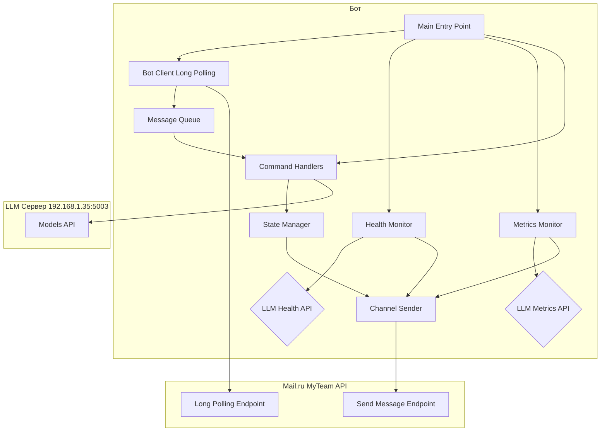
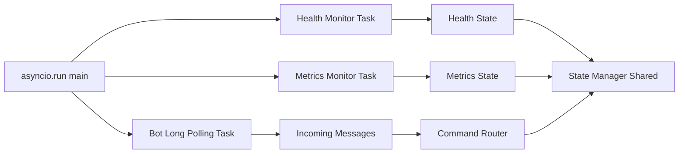
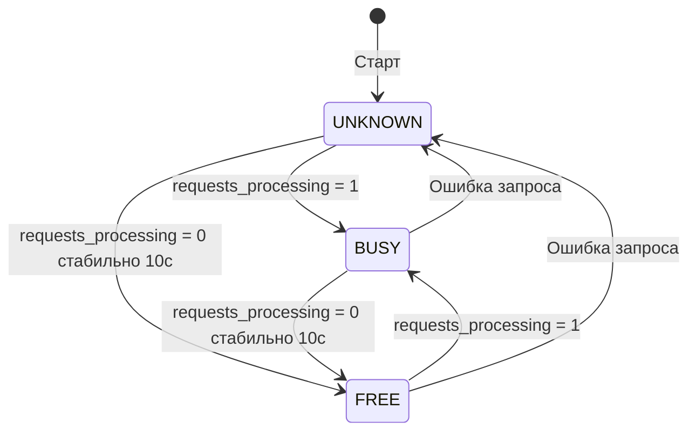

# Архитектура бота мониторинга LLM для Mail.ru MyTeam

## 1. Обзор системы

Бот работает в канале Mail.ru MyTeam (VK Workspace) и выполняет две основные функции:
- **Фоновый мониторинг**: периодический опрос LLM сервера (health + metrics)
- **Интерактивные команды**: ответ на запросы пользователей в канале



## 2. Структура проекта

```
llm-bot/
├── .env                    # Переменные окружения (в gitignore)
├── .env.example            # Шаблон переменных
├── .gitignore
├── requirements.txt        # Зависимости проекта
├── README.md               # Документация
│
├── main.py                 # Точка входа, инициализация бота
│
├── config/
│   ├── __init__.py
│   └── settings.py         # Загрузка и валидация .env, глобальные настройки
│
├── bot/
│   ├── __init__.py
│   ├── client.py           # Обёртка над mailru-im-bot SDK (long polling, отправка сообщений)
│   └── sender.py           # Утилиты отправки сообщений в канал
│
├── monitors/
│   ├── __init__.py
│   ├── base.py             # Базовый класс монитора (asyncio.Task, интервалы)
│   ├── health.py           # Монитор здоровья LLM (/health)
│   └── metrics.py          # Монитор метрик LLM (/metrics)
│
├── commands/
│   ├── __init__.py
│   ├── router.py           # Роутер команд (диспетчеризация по /command)
│   ├── status.py           # /status - статус занятости
│   ├── tokens.py           # /tokens - токены в секунду
│   ├── model.py            # /model - информация о модели
│   └── context.py          # /context - размер контекстного окна
│
├── state/
│   ├── __init__.py
│   └── manager.py          # Менеджер состояний (state machine для занятости)
│
└── utils/
    ├── __init__.py
    └── http_client.py      # Общий HTTP клиент для LLM API (httpx/aiosqlite)
```

### Файлы и их ответственность

| Файл | Описание |
|------|----------|
| [`main.py`](main.py) | Инициализация asyncio event loop, запуск мониторов и бота |
| [`config/settings.py`](config/settings.py) | Pydantic BaseSettings для .env, валидация типов |
| [`bot/client.py`](bot/client.py) | Инициализация SDK mailru-im-bot, long polling цикл |
| [`bot/sender.py`](bot/sender.py) | Отправка сообщений в канал с дедупликацией |
| [`monitors/base.py`](monitors/base.py) | ABC для мониторов с async def tick методом |
| [`monitors/health.py`](monitors/health.py) | Опрос /health, логика повторных уведомлений |
| [`monitors/metrics.py`](monitors/metrics.py) | Опрос /metrics, state machine занятости |
| [`commands/router.py`](commands/router.py) | Маппинг command_name -> handler |
| [`state/manager.py`](state/manager.py) | Хранение текущего состояния LLM (busy/free/unknown) |
| [`utils/http_client.py`](utils/http_client.py) | httpx.AsyncClient с retry логикой для LLM API |

## 3. Архитектура приложения

### 3.1. Асинхронная модель

Всё приложение работает на `asyncio` с параллельными задачами:



**Главный цикл** в [`main.py`](main.py):
```python
async def main():
    settings = load_settings()
    state = StateManager()
    http = HTTPClient(settings.llm_base_url)
    
    # Мониторы
    health_monitor = HealthMonitor(http, state, settings, channel_sender)
    metrics_monitor = MetricsMonitor(http, state, settings, channel_sender)
    
    # Бот
    bot = BotClient(settings, state, http, command_router)
    
    async with asyncio.TaskGroup() as tg:
        tg.create_task(bot.run())           # Long polling цикл
        tg.create_task(health_monitor.run()) # Опрос каждые N секунд
        tg.create_task(metrics_monitor.run()) # Опрос каждые M секунд
```

### 3.2. Long Polling цикл

Библиотека `mailru-im-bot` предоставляет SDK для работы с API MyTeam. Паттерн использования:

```python
from mailru_im_bot import Bot, LongPolling

bot = Bot(token=settings.bot_token)
lp = LongPolling(bot=bot)

@lp.on_message()
async def on_message(msg):
    if msg.command:
        await router.handle(msg.command, msg)
```

### 3.3. Отправка сообщений в канал

```python
class ChannelSender:
    def __init__(self, bot, channel_id: str, dry_run: bool):
        self.bot = bot
        self.channel_id = channel_id
        self.dry_run = dry_run
        self._last_message: Optional[str] = None
    
    async def send(self, text: str) -> None:
        if text == self._last_message:
            return  # Дедупликация - не спамить одинаковыми сообщениями
        
        if self.dry_run:
            logger.info(f"[DRY RUN] {text}")
        else:
            await self.bot.send_message(self.channel_id, text)
        
        self._last_message = text
```

## 4. API взаимодействия

### 4.1. LLM API (llama.cpp)

| Метод | Endpoint | Описание | Ответ |
|-------|----------|----------|-------|
| GET | `/health` | Проверка доступности | `"OK"` или ошибка |
| GET | `/metrics` | Prometheus метрики | Текст с метриками |
| GET | `/models` | Список моделей | JSON с info модели |

**Парсинг метрик** из `/metrics`:
```
llamacpp:requests_processing 1
llamacpp:prompt_tokens_seconds 15.3
llamacpp:predicted_tokens_seconds 42.7
```

### 4.2. MyTeam Bot API

Ключевые эндпоинты (через SDK mailru-im-bot):

| Действие | SDK Метод | Описание |
|----------|-----------|----------|
| Long Polling | `LongPolling()` | Получение событий (сообщения, команды) |
| Отправка сообщения | `bot.send_message(chat_id, text)` | Отправка в канал |
| Информация о боте | `bot.get_self()` | Проверка токена |

## 5. State Machine для мониторинга занятости

### 5.1. Состояния



### 5.2. Реализация StateManager

```python
from enum import Enum
from dataclasses import dataclass
import time

class LLMStatus(Enum):
    UNKNOWN = "unknown"
    FREE = "free"
    BUSY = "busy"

@dataclass
class ModelState:
    name: str = ""
    context_length: int = 0

class StateManager:
    def __init__(self):
        self._health_status: LLMStatus = LLMStatus.UNKNOWN
        self._busy_status: LLMStatus = LLMStatus.UNKNOWN
        self._model: ModelState = ModelState()
        self._metrics_cache: dict = {}
        
        # Для стабильности статуса FREE
        self._free_since: float = 0  # Timestamp когда стало 0
        self._last_busy_check: float = 0
    
    # Свойства доступа
    @property
    def health_status(self) -> LLMStatus:
        return self._health_status
    
    @property
    def busy_status(self) -> LLMStatus:
        return self._busy_status
    
    @property
    def model(self) -> ModelState:
        return self._model
    
    # Обновление из мониторов
    def update_health(self, is_healthy: bool):
        old = self._health_status
        self._health_status = LLMStatus.FREE if is_healthy else LLMStatus.UNKNOWN
        return old != self._health_status  # True если изменилось
    
    def update_busy(self, is_processing: int):
        now = time.time()
        old = self._busy_status
        
        if is_processing == 1:
            self._busy_status = LLMStatus.BUSY
            self._free_since = 0
        elif is_processing == 0:
            if self._free_since == 0:
                self._free_since = now  # Начали отсчёт стабильности
            
        return old != self._busy_status
    
    def check_free_stability(self, stability_seconds: int) -> bool:
        """Проверить что статус FREE стабилен достаточно долго."""
        if self._free_since == 0:
            return False
        elapsed = time.time() - self._free_since
        return elapsed >= stability_seconds
```

### 5.3. Логика монитора метрик

```python
class MetricsMonitor(BaseMonitor):
    async def tick(self):
        metrics = await self._http.get_metrics()
        is_processing = metrics.get("requests_processing", -1)
        
        changed = self.state.update_busy(is_processing)
        
        if changed and self.state.busy_status == LLMStatus.BUSY:
            await self.sender.send("🔴 LLM занята")
        
        if is_processing == 0 and self.state.check_free_stability(self.settings.stability_interval):
            if self.state.busy_status != LLMStatus.FREE:
                self.state._busy_status = LLMStatus.FREE
                await self.sender.send("🟢 LLM свободна")
```

## 6. Команды бота

### 6.1. Список команд

| Команда | Описание | Пример ответа |
|---------|----------|---------------|
| `/status` | Текущий статус занятости | `🟢 LLM свободна` или `🔴 LLM занята` |
| `/tokens` | Скорость генерации токенов | `📊 Prompt: 15.3 t/s, Generation: 42.7 t/s` |
| `/model` | Информация о модели | `🤖 Model: llama-3.1-8b, Context: 8192` |
| `/context` | Размер контекстного окна | `📏 Context window: 8192 tokens` |
| `/health` | Статус здоровья | `✅ LLM: OK` или `❌ LLM: Not Available` |

### 6.2. Роутер команд

```python
class CommandRouter:
    def __init__(self):
        self._handlers: Dict[str, Callable] = {}
    
    def register(self, command: str):
        def decorator(func: Callable):
            self._handlers[command] = func
            return func
        return decorator
    
    async def handle(self, command: str, message) -> str:
        handler = self._handlers.get(command)
        if handler is None:
            return f"Неизвестная команда: /{command}"
        return await handler()

# Регистрация
router = CommandRouter()

@router.register("status")
async def status_handler():
    status_emoji = {"free": "🟢", "busy": "🔴", "unknown": "⚪"}
    emoji = status_emoji[state.busy_status.value]
    return f"{emoji} LLM {'свободна' if state.busy_status == LLMStatus.FREE else 'занята'}"
```

## 7. Конфигурация (.env)

### 7.1. Текущие переменные

| Переменная | Тип | Описание | По умолчанию |
|------------|-----|----------|--------------|
| `BOT_TOKEN` | string | Токен бота MyTeam | - |
| `CHANNEL_ID` | string | ID канала для сообщений | - |
| `API_URL` | string | Base URL MyTeam API | `https://myteam.mail.ru` |
| `LLM_BASE_URL` | string | Base URL LLM сервера | `http://192.168.1.35:5003` |
| `HEALTH_CHECK_INTERVAL` | int | Интервал опроса /health (сек) | `30` |
| `HEALTH_REPEAT_INTERVAL` | int | Интервал повторного уведомления об ошибке (сек) | `300` |
| `METRICS_CHECK_INTERVAL` | int | Интервал опроса /metrics (сек) | `3` |
| `STABILITY_INTERVAL` | int | Таймаут стабильности статуса FREE (сек) | `10` |
| `DRY_RUN` | bool | Режим тестирования без отправки | `0` |

### 7.2. Pydantic Settings

```python
# config/settings.py
from pydantic_settings import BaseSettings, SettingsConfigDict

class Settings(BaseSettings):
    model_config = SettingsConfigDict(
        env_file=".env",
        env_file_encoding="utf-8",
        case_sensitive=False
    )
    
    # Bot
    bot_token: str
    channel_id: str
    api_url: str = "https://myteam.mail.ru"
    
    # LLM
    llm_base_url: str = "http://192.168.1.35:5003"
    
    #_intervals_
    health_check_interval: int = 30
    health_repeat_interval: int = 300
    metrics_check_interval: int = 3
    stability_interval: int = 10
    
    # Mode
    dry_run: bool = False
```

## 8. Обработка состояний (антиспам)

### 8.1. Проблема
При каждом опросе (каждые 3 секунды) не нужно спамить сообщениями в канал.

### 8.2. Решение: Дедупликация + State Change Detection

```python
class AntiSpamSender:
    def __init__(self, sender: ChannelSender):
        self.sender = sender
        self._last_sent: Dict[str, str] = {}  # key -> last_message
        self._cooldown_until: Dict[str, float] = {}  # key -> timestamp
    
    async def send_if_changed(self, key: str, message: str, cooldown: int = 0):
        """Отправить только если сообщение изменилось или прошёл кулдаун."""
        now = time.time()
        
        # Проверка кулдауна
        if key in self._cooldown_until:
            if now < self._cooldown_until[key]:
                return  # Ещё кулдаун
        
        # Проверка дедупликации
        if self._last_sent.get(key) == message:
            return  # Сообщение не изменилось
        
        await self.sender.send(message)
        self._last_sent[key] = message
        
        if cooldown > 0:
            self._cooldown_until[key] = now + cooldown
```

### 8.3. Ключи состояний

| Ключ | Описание | Кулдаун |
|------|----------|---------|
| `health.down` | Сообщение о недоступности LLM | 300 сек |
| `health.up` | Сообщение о восстановлении LLM | 0 |
| `metrics.busy` | Сообщение о занятости | 0 |
| `metrics.free` | Сообщение о свободе | 0 |

## 9. Зависимости

```txt
# requirements.txt
mailru-im-bot>=1.0.0    # SDK для Mail.ru MyTeam ботов
httpx>=0.27.0           # Асинхронный HTTP клиент
pydantic>=2.0.0         # Валидация моделей
pydantic-settings>=2.0.0 # Загрузка .env
python-dotenv>=1.0.0    # Поддержка .env файлов
structlog>=24.0.0       # Логирование (опционально)
```

## 10. Запуск и деплой

### 10.1. Локальный запуск
```bash
python -m venv .venv
source .venv/bin/activate
pip install -r requirements.txt
python main.py
```

### 10.2. Dry-run режим
```bash
python main.py --dry-run
# Или через .env: DRY_RUN=1
```

### 10.3. Системный сервис (systemd)
```ini
# /etc/systemd/system/llm-bot.service
[Unit]
Description=LLM Monitoring Bot for Mail.ru MyTeam
After=network.target

[Service]
Type=simple
User=romanzhulin
WorkingDirectory=/home/romanzhulin/llm-bot
Environment=PATH=/home/romanzhulin/llm-bot/.venv/bin
ExecStart=/home/romanzhulin/llm-bot/.venv/bin/python main.py
Restart=always
RestartSec=10

[Install]
WantedBy=multi-user.target
```

## 11. Логирование

```python
import structlog

structlog.configure(
    processors=[
        structlog.processors.add_log_level,
        structlog.processors.TimeStamper(fmt="iso"),
        structlog.processors.JSONRenderer()
    ]
)

logger = structlog.get_logger()
```

Уровни логирования:
- `INFO`: Изменения состояния, команды пользователей
- `WARNING`: Ошибки HTTP запросов к LLM (с retry)
- `ERROR`: Критические ошибки (падение монитора)
- `DEBUG`: Детали опросов (значение метрик)

## 12. Рекомендации по реализации

### 12.1. Приоритет разработки

1. **Основной цикл** — main.py + config/settings.py
2. **HTTP клиент** — utils/http_client.py (тестирование на живом LLM)
3. **State Manager** — state/manager.py (ядро логики)
4. **Монитор здоровья** — monitors/health.py (простой, быстрый win)
5. **Монитор метрик** — monitors/metrics.py (state machine)
6. **Bot Client** — bot/client.py (интеграция с SDK)
7. **Команды** — commands/* (интерактивность)
8. **Антиспам** — улучшение UX

### 12.2. Обработка ошибок

- **HTTP Timeout**: 5 секунд на запрос к LLM API
- **Retry**: 3 попытки с exponential backoff (1s, 2s, 4s)
- **Circuit Breaker**: Если 5 ошибок подряд, приостановить опрос на 30 секунд
- **Graceful Shutdown**: SIGTERM -> отмена asyncio задач -> выход

### 12.3. Тестирование

```python
# tests/
├── test_settings.py       # Валидация .env
├── test_state_manager.py  # State machine логика
├── test_health_monitor.py # Mock HTTP responses
├── test_metrics_monitor.py
└── test_commands.py
```

### 12.4. Известные ограничения SDK mailru-im-bot

- Long polling может терять соединения при сетевых проблемах — реализовать reconnect
- Ограничение на частоту отправки сообщений в канал — учтите антиспам
- Команды в канале требуют упоминания бота: `@bot_name /command` или просто `/command`